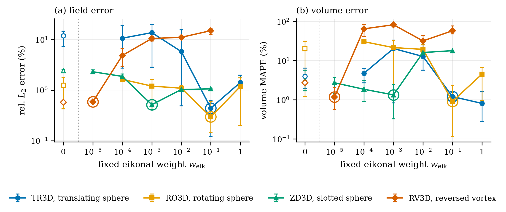
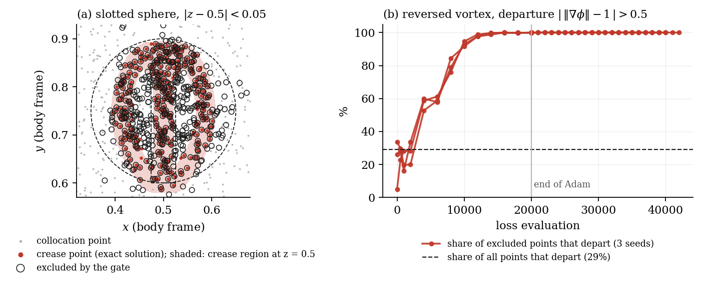
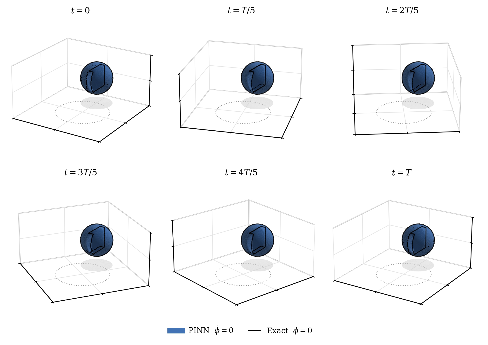
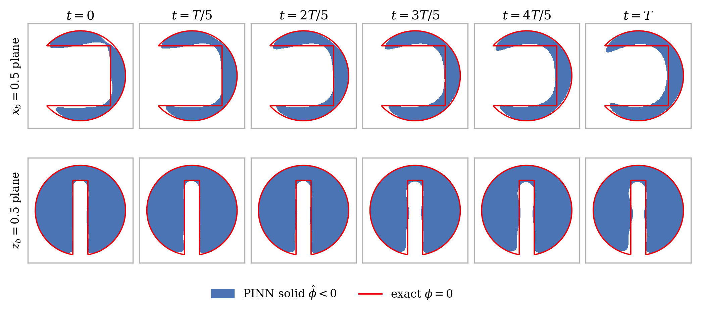
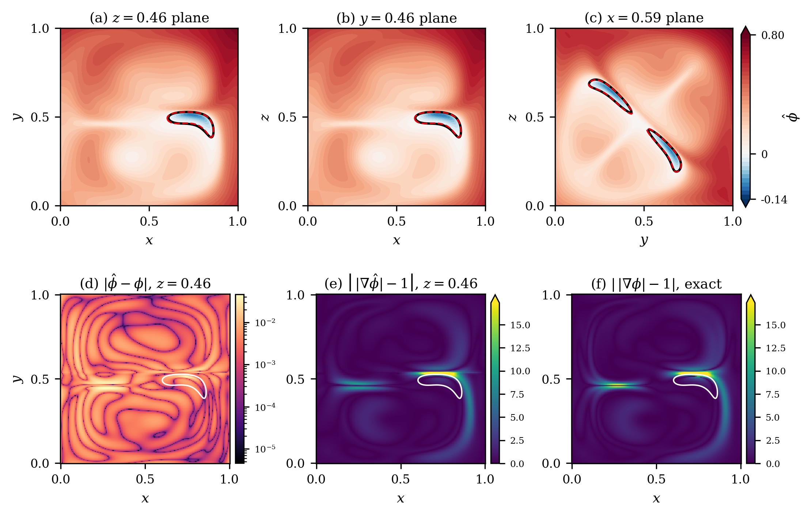
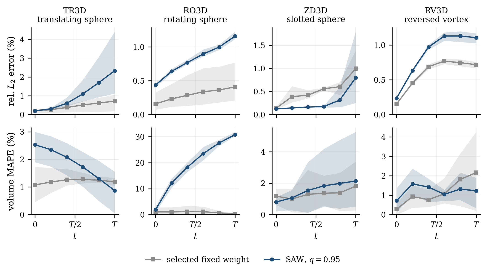
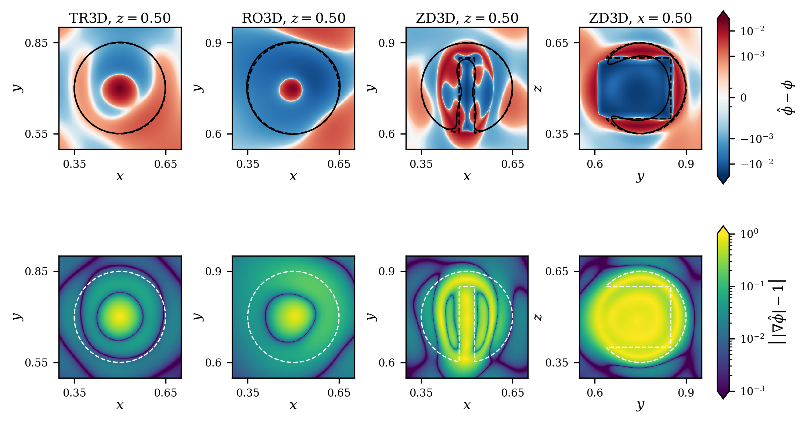

# SDF-Aware Weighting: Adaptive Eikonal Regularisation for Three-Dimensional Level-Set Physics-Informed Neural Networks

[](https://python.org)
[](https://pytorch.org)
[](LICENSE)
[](https://doi.org/10.5281/zenodo.21852143)

> Code and results for **SDF-Aware Weighting (SAW)**, an adaptive eikonal
> regularisation scheme for 3D level-set PINNs, by Muhammad Akbar Khan and
> Fahim Raees. The training protocol is inherited from
> [`pinn-level-set`](https://github.com/AkbarTheAnalyst/pinn-level-set)
> (Khan & Raees, *Machine Learning: Science and Technology*, 2026,
> [doi:10.1088/2632-2153/ae8b74](https://doi.org/10.1088/2632-2153/ae8b74)),
> which identified the eikonal weight as the dominant hyperparameter but
> located it by a sweep of eighteen runs per benchmark.

---

## Overview

Physics-informed neural networks for level-set advection

$$\frac{\partial \phi}{\partial t} + \mathbf{u}\cdot\nabla\phi = 0, \qquad \mathbf{x}\in\Omega=[0,1]^3$$

often add an eikonal regulariser that penalises the deviation of
$\lVert\nabla\phi\rVert$ from one. Adaptive loss balancing assumes that every
term of the loss should be driven to zero. For the eikonal term this fails:
$\lVert\nabla\phi\rVert = 1$ survives transport only under rigid motion of a
smooth interface, so wherever the exact solution departs from a signed-distance
function (under strain, or near the crease of a constructive-solid-geometry
initial field) its own eikonal residual is nonzero. Gradient-norm balancing reads
that residual as network error, and its weight stays at its initial value.

SAW excludes the upper tail of the eikonal residual (a residual-quantile gate,
quantile $q$) before a gradient-norm ratio sets the weight.

This repository contains:

1. **Fixed-weight sweeps** on four 3D benchmarks (six weights, three seeds each,
   selection rule fixed in advance).
2. **SAW runs** at $q = 0.95$ (fixed in advance) and the gate switched off
   ($q = 1$, plain gradient-norm balancing).
3. **Controls and diagnostics** ([`ablations/`](ablations/)): SAW's weight
   schedule replayed without the gate, a random 5% gate, the gated points
   compared with labels from the exact solution, gradient norms with the gate on
   and off, the sensitivity to $q$, and two extra seeds on ZD3D.
4. **A WENO5 + TVD-RK3 baseline** on the same grids, snapshots and error measures.

**Main findings**
- Without the gate, the eikonal term holds the network near unit gradient
  everywhere. The eikonal gradient collapses while the PDE and initial-condition
  gradients stay large, so the weight stays at its clip. This explains the
  degradation reported by Mullins et al. (2025) when they put the eikonal term
  into gradient normalisation.
- On the slotted sphere, SAW at $q = 0.95$ beats the weight an eighteen-run sweep
  selected on each of five seeds (0.227% against 0.559% relative $L_2$ error).
- On the reversed vortex, SAW (0.868%) does not beat the best fixed weight
  (0.588%), but every fixed weight from $10^{-4}$ upwards gives 4.9–15.1%.
- The gate, not the weight schedule, does the work: SAW's own schedule replayed
  without the gate fills the slot, and a random 5% gate fails like no gate.
  The gate removes about 95% of the crease points of the slotted sphere and, on
  the vortex, almost only points where the exact solution departs from unit
  gradient.
- On the slotted sphere the result is flat for $q$ from 0.90 to 0.97; on the
  vortex $q = 0.90$ is about a fifth better than 0.95; $q = 0.99$ fails on both.
  $q = 0.90$ is the recommended value for new problems.
- On the two smooth rigid benchmarks SAW is not needed: the exact solution stays
  a signed-distance function, and a fixed weight between $10^{-1}$ and $1$ should
  be used.
- The relative $L_2$ error cannot tell a filled slot from a resolved one; a
  sign-based, feature-restricted measure is reported.
- WENO5 is more accurate on all four benchmarks, by a factor of 105 on the
  translating sphere, narrowing to 4.3 on the reversed vortex.

---

## Benchmarks

Four benchmarks on the unit cube $\Omega=[0,1]^3$, ordered by how far their exact
solution departs from a signed-distance function:

| Benchmark | Description | $T$ | Selected $w_\text{eik}$ |
|---|---|---|---|
| **TR3D** — Translating sphere | Uniform velocity, rigid | $5$ | $10^{-1}$ |
| **RO3D** — Rotating sphere | Solid-body rotation, rigid | $2\pi$ | $10^{-1}$ |
| **ZD3D** — Zalesak slotted sphere | Rotation + thin blind-pocket slot | $2\pi$ | $10^{-3}$ |
| **RV3D** — Reversed single vortex | Enright (2002) deformation field | $2$ | $10^{-5}$ |

### Fixed-weight baseline (selected weight, seed 42, 201³ grid, 6 snapshots)

| Benchmark | abs. $L_2$ | rel. $L_2$ (%) | volume MAPE (%) | eikonal dev. | time (min) |
|---|---|---|---|---|---|
| TR3D | 4.73e-4 | 0.122 | 1.143 | 1.31e-2 | 11.8 |
| RO3D | 6.76e-4 | 0.160 | 0.117 | 2.08e-2 | 15.6 |
| ZD3D | 2.03e-3 | 0.480 | 0.328 | 1.02e-1 | 24.9 |
| RV3D | 2.52e-3 | 0.591 | 0.564 | 5.97e-1 | 23.7 |

Timings are for a single NVIDIA T4.

### SAW against the fixed weight (mean ± std over seeds 42–44)

| Benchmark | Fixed weight, rel. $L_2$ (%) | SAW $q=0.95$, rel. $L_2$ (%) | SAW $q=0.95$, MAPE (%) | Gate off, rel. $L_2$ (%) | SAW final $w_\text{eik}$ |
|---|---|---|---|---|---|
| TR3D | **0.442 ± 0.227** | 1.035 ± 0.539 | 1.811 ± 0.526 | 0.449 ± 0.193 (2 seeds) | 5.11e-2 |
| RO3D | **0.297 ± 0.205** | 0.816 ± 0.032 | 19.045 ± 1.251 | 1.593 ± 0.096 | 1.79e-1 |
| ZD3D | 0.516 ± 0.105 | **0.285 ± 0.155** | 1.561 ± 1.167 | 1.057 ± 0.015 | 2.25e-3 |
| RV3D | **0.588 ± 0.026** | 0.868 ± 0.036 | 1.219 ± 0.438 | 14.976 ± 0.538 | 8.25e-5 |

ZD3D over five seeds (42–46): SAW 0.227 ± 0.140%, fixed weight 0.559 ± 0.170%.
SAW at $q = 0.90$ (seeds 42–44): ZD3D 0.208 ± 0.034%, RV3D 0.708 ± 0.018%.

### Controls (ZD3D / RV3D, relative $L_2$ error %)

| Configuration | ZD3D | RV3D |
|---|---|---|
| SAW, $q = 0.95$ | **0.285 ± 0.155** | **0.868 ± 0.036** |
| Replay of SAW's weight schedule, gate off | 1.003 ± 0.008 | 2.403 ± 0.324 |
| Random 5% gate (seed 42) | 1.442 | 13.410 |
| Gate off ($q = 1$) | 1.057 ± 0.015 | 14.976 ± 0.538 |

Full per-run results are in [`results/`](results/) and
[`results/ablations/`](results/ablations/).

---

## Architecture & Training

Same base architecture on all four benchmarks, inherited from the 2D study.

```
Input: (x, y, z, tau_norm) in R^4
  -> 8 x [Linear(256) -> Tanh]
       -> Linear(1)
Output: phi_hat(x, y, z, tau_norm) in R
```

| Hyperparameter | Value |
|---|---|
| Hidden layers | 8 |
| Neurons per layer | 256 |
| Activation | Tanh |
| Weight init | Xavier |
| $w_\text{pde}$, $w_\text{ic}$ | $1$, $10$ (fixed) |
| $w_\text{eik}$ | swept: 6 log-spaced values over 4 decades, incl. 0 (control) |
| Optimiser | Adam (2×10⁴ iters, cosine 10⁻³→10⁻⁵) then L-BFGS (strong-Wolfe) |
| Seeds | 42, 43, 44 (control init *and* collocation sampling) |
| Eval grid | 201³ ($\Delta x = 0.005$), 6 snapshots $t=0,T/5,\dots,T$ |
| **SAW** $\beta$, $q$ | **0.999, 0.95** (fixed in advance); $q = 0.90$ recommended after the sensitivity study |

ZD3D also uses a random Fourier feature encoding (128 features, $\sigma=5$).
ZD3D and RV3D also use residual-based adaptive sampling (RAD/RAR) and causal loss
weighting ($M=32$ and $M=10$ chunks).

---

## Figures

- Architecture and training:

  

- Fixed-weight sweeps: error against the eikonal weight on all four benchmarks:

  

- What the gate removes (slotted sphere slice; precision on the vortex):

  

- ZD3D interface at six snapshots; the camera turns with the body so the slot,
  which opens towards the rotation axis, stays in view:

  

- Slotted sphere in sections fixed to the body, six snapshots:

  

- RV3D interface:

  

- RV3D at the largest deformation: the network's eikonal deviation against the
  reference solution's:

  

- Error over time on all four benchmarks, fixed weight against SAW (three seeds):

  

- Signed error and eikonal deviation near the interface at $t=T$ for TR3D, RO3D
  and ZD3D, on common colour scales:

  

---

## Installation

```bash
git clone https://github.com/AkbarTheAnalyst/pinn-level-set-3d-saw.git
cd pinn-level-set-3d-saw
pip install -r requirements.txt
```

Code and data are archived on Zenodo:
[doi:10.5281/zenodo.21852143](https://doi.org/10.5281/zenodo.21852143)

---

## Repository Structure

```
pinn-level-set-3d-saw/
├── tr3d/, ro3d/, zd3d/, rv3d/   # per-benchmark core code and notebooks:
│                                #   01 fixed-weight sweep, 02 SAW sweep, 03 train and evaluate
├── weno/                        # WENO5 + TVD-RK3 baseline
├── ablations/                   # controls, diagnostics, q sensitivity (see ablations/README.md)
├── figures/                     # all figures (PDF/PNG) and the scripts that make them
├── results/                     # sweep CSVs, SAW weight histories
│   └── ablations/               # one folder per ablation notebook
├── assets/                      # paper-ready images
├── requirements.txt
├── LICENSE
├── CITATION.cff
└── README.md
```

---

## Reproducing the results

| Result | Where |
|---|---|
| Fixed-weight sweep (6 weights × 3 seeds) | `<bench>/01_eikonal_ablation.ipynb` → `results/<BENCH>_eikonal_ablation*.csv` |
| SAW at $q = 0.95$ and gate off (3 seeds) | `<bench>/02_saw_sweep_<BENCH>.ipynb` → `results/<BENCH>_saw_sweep.csv`, `results/weight_history/` |
| Reported runs and figures | `<bench>/03_train_and_evaluate.ipynb` → `results/<BENCH>_results.csv`, `figures/` |
| Controls, diagnostics, $q$ sensitivity, extra seeds | `ablations/notebooks/` → `results/ablations/` |
| Gate figure | `python figures/fig_gate.py` |
| Sweep, growth, verification and ZD3D section figures | `python figures/make_figures.py` (`sweep`, `growth`, `verification`, `rv`, `zd`, `zoom` for the combined TR3D/RO3D/ZD3D verification figure, or no argument for all); needs the seed-42 `.pth` checkpoints, which are not in the repository; set `SAW_MODELS` to their folder |
| ZD3D interface figure | `python figures/zd3d_interface_follow.py` (needs the seed-42 ZD3D checkpoint) |
| SAW weight trajectory figure | `python figures/fig_weight_trajectory.py` |
| WENO baseline | `weno/weno_baseline.ipynb` |

The notebooks are written for Google Colab with a T4 GPU.
`ablations/tests/test_local.py` checks on CPU that the ablation code reproduces
the original SAW exactly.

---

## References

- Osher, S., & Sethian, J. A. (1988). Fronts propagating with
  curvature-dependent speed. *Journal of Computational Physics*, 79(1), 12–49.
- Raissi, M., Perdikaris, P., & Karniadakis, G. E. (2019). Physics-informed
  neural networks. *Journal of Computational Physics*, 378, 686–707.
- Krishnapriyan, A., et al. (2021). Characterizing possible failure modes
  in physics-informed neural networks. *NeurIPS*, 34, 26548–26560.
- Mullins, M., Kamil, H., Fahsi, A., & Soulaïmani, A. (2025). Physics-informed
  neural networks for solving moving interface flow problems using the level set
  approach. *Physics of Fluids*, 37(10). doi:10.1063/5.0289386.
- Enright, D., et al. (2002). A hybrid particle level set method for
  improved interface capturing. *Journal of Computational Physics*.
- Jiang, G.-S., & Shu, C.-W. (1996). Efficient implementation of weighted
  ENO schemes. *Journal of Computational Physics*, 126(1), 202–228.
- Shu, C.-W., & Osher, S. (1988). Efficient implementation of essentially
  non-oscillatory shock-capturing schemes. *Journal of Computational
  Physics*, 77(2), 439–471.
- Tancik, M., et al. (2020). Fourier features let networks learn high
  frequency functions in low dimensional domains. *NeurIPS*, 33, 7537–7547.
- Wang, S., Sankaran, S., & Perdikaris, P. (2024). Respecting causality
  for training physics-informed neural networks. *CMAME*, 421, 116813.
- Khan, M. A., & Raees, F. (2026). A systematic study of physics-informed
  neural networks for the level-set interface advection. *Machine
  Learning: Science and Technology*. doi:10.1088/2632-2153/ae8b74.

---

## Citation

```bibtex
@misc{khan2026sawcode,
  author    = {Khan, Muhammad Akbar and Raees, Fahim},
  title     = {{SDF-Aware Weighting}: Adaptive Eikonal Regularisation for
               Three-Dimensional Level-Set Physics-Informed Neural Networks
               --- Source Code},
  year      = {2026},
  publisher = {Zenodo},
  doi       = {10.5281/zenodo.21852143},
  url       = {https://doi.org/10.5281/zenodo.21852143}
}
```

---

## Authors

**Muhammad Akbar Khan**, MS Applied Mathematics, NED University of Engineering &
Technology. akbar.bsma1337@gmail.com · [GitHub](https://github.com/AkbarTheAnalyst) ·
[ORCID 0009-0001-7956-0080](https://orcid.org/0009-0001-7956-0080) ·
[Website](https://akbarkhan.dev)

**Dr. Fahim Raees**, Associate Professor, Department of Mathematics, NED
University of Engineering & Technology. fahimned@neduet.edu.pk
