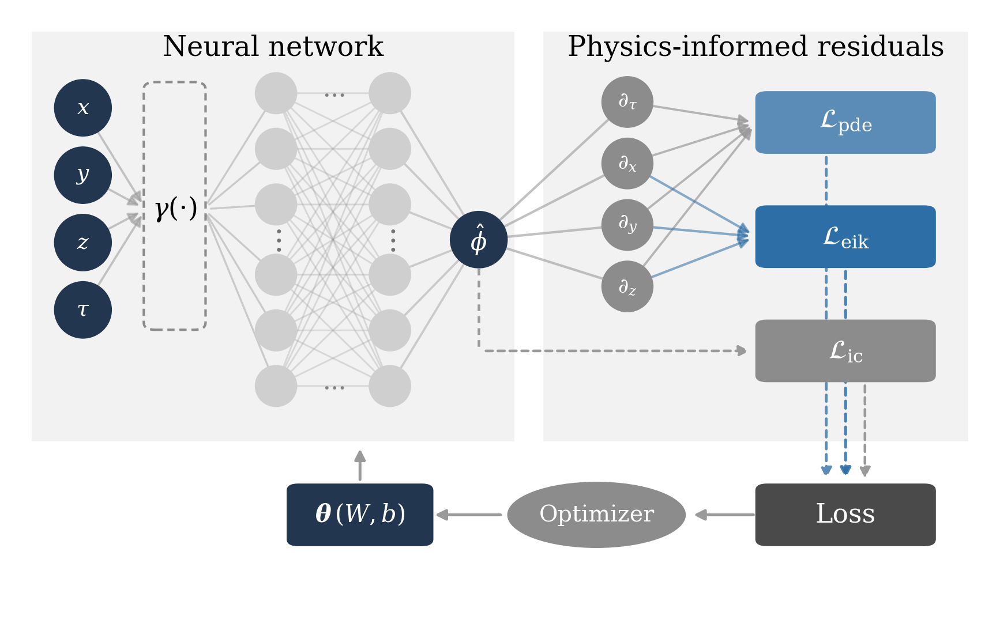
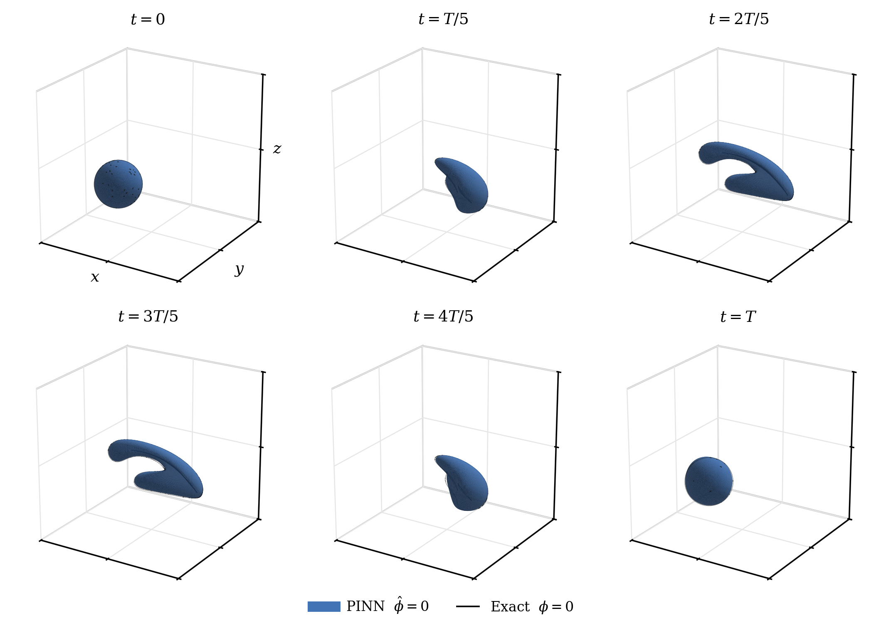
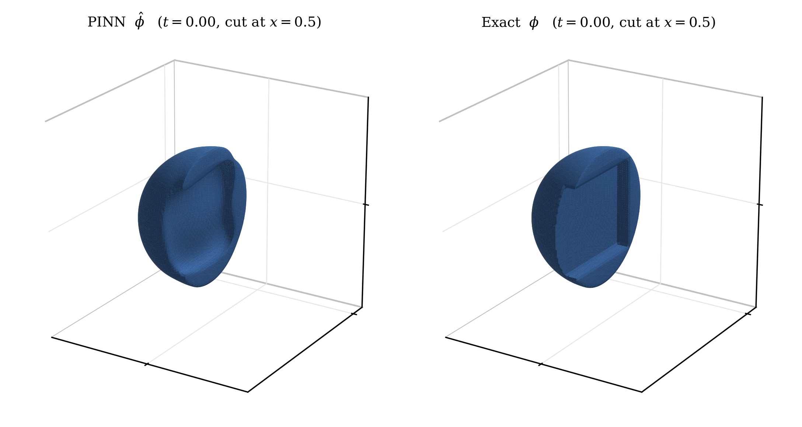
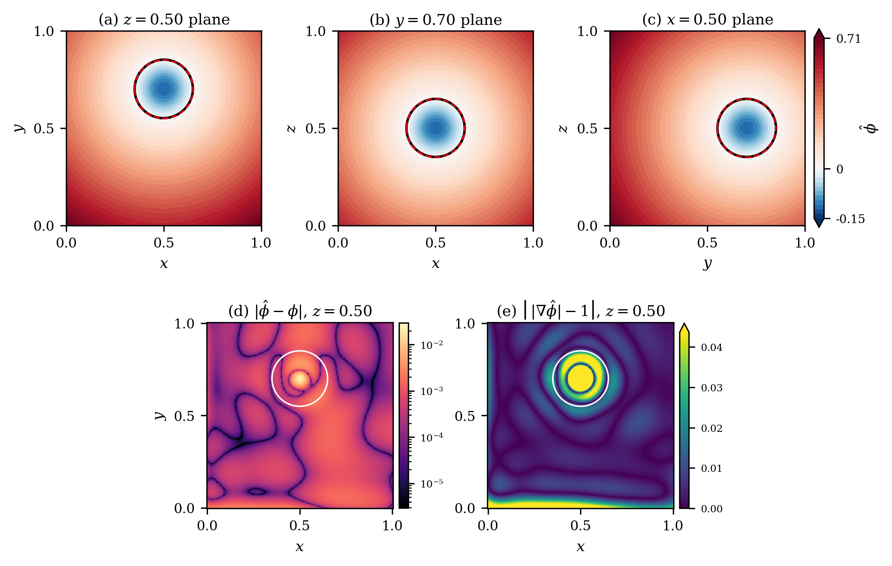

# SDF-Aware Weighting: Adaptive Eikonal Regularisation for Three-Dimensional Level-Set Physics-Informed Neural Networks

[](https://python.org)
[](https://pytorch.org)
[](LICENSE)
[](https://doi.org/10.5281/zenodo.21860060)

> Code for **SDF-Aware Weighting (SAW)**, an adaptive eikonal regularisation
> scheme for 3D level-set PINNs. The training protocol is inherited from
> [`pinn-level-set`](https://github.com/AkbarTheAnalyst/pinn-level-set)
> (Khan & Raees, *Machine Learning: Science and Technology*, 2026,
> [doi:10.1088/2632-2153/ae8b74](https://doi.org/10.1088/2632-2153/ae8b74)),
> which identified the eikonal weight as the dominant hyperparameter but
> located it by sweep — eighteen runs per benchmark. SAW replaces that
> sweep with a single run.

---

## Overview

Physics-informed neural networks for level-set advection

$$\frac{\partial \phi}{\partial t} + \mathbf{u}\cdot\nabla\phi = 0, \qquad \mathbf{x}\in\Omega=[0,1]^3$$

commonly augment the loss with an eikonal regulariser penalising the
deviation of $\lVert\nabla\phi\rVert$ from unity. Standard adaptive
loss-balancing schemes assume every residual in the composite objective
should be driven to zero. For the eikonal term that assumption fails:
where the exact solution is not a signed-distance function, the eikonal
residual of the correct answer is nonzero, and a scheme that drives it
towards zero moves the network away from that answer.

This repository contains:

1. **Fixed-weight sweeps** across four 3D benchmarks (six weights, three
   random seeds each, selection rule fixed in advance), establishing the
   target each adaptive scheme must recover.

2. **SDF-Aware Weighting (SAW)**, which combines a residual-quantile gate
   with a gradient-norm ratio so that points exhibiting legitimate departure
   from the signed-distance property are excluded before the surviving term
   is scaled. With one fixed configuration SAW selects a weight within an
   order of magnitude of the swept optimum on every benchmark, spanning
   four decades, at the cost of a single training run.

3. **A gate ablation** isolating SAW's two components, showing that
   gradient-norm balancing alone fails to descend on the benchmarks where
   the signed-distance property is violated.

4. **A WENO5 + TVD-RK3 baseline** on the same grids, snapshots, and error
   measures.

**Key findings:**
- Standard gradient-norm balancing fails structurally on this problem
  class: the eikonal weight stays at its initial value for the whole of
  training on the benchmarks where the signed-distance property is
  violated.
- SAW recovers the weight an eighteen-run sweep selects, reproduces the
  ordering across four decades, and on the slotted sphere attains a lower
  error than any weight the sweep examined — in a single run.
- SAW is worse than a fixed weight on the two smooth rigid benchmarks,
  where the signed-distance property holds everywhere. This is expected
  and reported.
- The 2D weight-selection ordering transfers to 3D. The specific values
  transfer only partially: two of the four carry over unchanged; the
  translating sphere moves from $1$ to $10^{-1}$ and the reversed vortex
  from $10^{-4}$ to $10^{-5}$.
- With three seeds per configuration, the seed-to-seed standard deviation
  at small weights is of the same order as the error itself; the
  regulariser reduces it by more than an order of magnitude — it buys
  reproducibility as well as accuracy.
- Against WENO5 on identical grids and measures, the classical scheme is
  more accurate on all four benchmarks — by a factor of $105$ on smooth
  rigid advection, narrowing to $4.3$ under deformation.
- The standard relative $L_2$ error cannot certify thin features: on the
  slotted sphere, removing the slot entirely changes it by about one
  percentage point. We report a sign-based, feature-restricted measure
  that can.

---

## Benchmarks

Four benchmarks on the unit cube $\Omega=[0,1]^3$, ordered by how far
their exact solution departs from a signed-distance function:

| Benchmark | Description | $T$ | Selected $w_\text{eik}$ |
|---|---|---|---|
| **TR3D** — Translating sphere | Uniform velocity, rigid | $5$ | $10^{-1}$ |
| **RO3D** — Rotating sphere | Solid-body rotation, rigid | $2\pi$ | $10^{-1}$ |
| **ZD3D** — Zalesak slotted sphere | Rotation + thin blind-pocket slot | $2\pi$ | $10^{-3}$ |
| **RV3D** — Reversed single vortex | Enright (2002) deformation field | $2$ | $10^{-5}$ |

### Fixed-weight baseline (selected weight, seed 42, 201³ grid, 6 snapshots)

| Benchmark | abs. $L_2$ | rel. $L_2$ (%) | volume MAPE (%) | eikonal dev. | time (min) |
|---|---|---|---|---|---|
| TR3D | 4.73e-4 | 0.122 | 1.143 | 1.31e-2 | 11.8 |
| RO3D | 6.76e-4 | 0.160 | 0.117 | 2.08e-2 | 15.6 |
| ZD3D | 2.03e-3 | 0.480 | 0.328 | 1.02e-1 | 27.1 |
| RV3D | 2.52e-3 | 0.591 | 0.564 | 5.97e-1 | 23.7 |

Timings are for a single NVIDIA T4.

### SAW results ($\beta = 0.999$, $q = 0.95$, mean over 3 seeds)

| Benchmark | rel. $L_2$ (%) | volume MAPE (%) | converged $w_\text{eik}$ |
|---|---|---|---|
| TR3D | 1.035 ± 0.539 | 1.811 ± 0.526 | 5.11e-2 |
| RO3D | 0.816 ± 0.032 | 19.045 ± 1.251 | 1.79e-1 |
| ZD3D | **0.285 ± 0.155** | 1.561 ± 1.167 | 2.25e-3 |
| RV3D | 0.868 ± 0.036 | 1.218 ± 0.439 | 8.25e-5 |

SAW improves on the fixed-weight sweep on ZD3D and is within a factor of
1.5 on RV3D; it is worse on TR3D and RO3D, where the premise does not
hold. Full per-weight sweep tables (mean ± std over 3 seeds) are in the
benchmark-specific CSV files.

---

## Architecture & Training

Same base architecture across all four benchmarks, inherited from the 2D
study. Only the eikonal weight, sampling strategy, and causal-weighting
chunk count differ.

```
Input: (x, y, z, tau_norm) in R^4
  -> 8 x [Linear(256) -> Tanh]
       -> Linear(1)
Output: phi_hat(x, y, z, tau_norm) in R
```

| Hyperparameter | Value |
|---|---|
| Hidden layers | 8 |
| Neurons per layer | 256 |
| Activation | Tanh |
| Weight init | Xavier |
| $w_\text{pde}$, $w_\text{ic}$ | $1$, $10$ (fixed) |
| $w_\text{eik}$ | swept: 6 log-spaced values over 4 decades, incl. 0 (control) |
| Optimiser | Adam (2×10⁴ iters, cosine 10⁻³→10⁻⁵) then L-BFGS (strong-Wolfe) |
| Seeds | 42, 43, 44 (controls init *and* collocation sampling) |
| Eval grid | 201³ ($\Delta x = 0.005$), 6 snapshots $t=0,T/5,\dots,T$ |
| **SAW** $\beta$, $q$ | **0.999, 0.95** (fixed across all benchmarks) |

ZD3D additionally uses a random Fourier feature encoding (128 features,
$\sigma=5$). ZD3D and RV3D additionally use residual-based adaptive
sampling (RAD/RAR) and causal loss weighting ($M=32$ and $M=10$ chunks
respectively).

---

## Embedded Figures (GitHub preview)

- Architecture & Training:

  

- RV3D interface:

  

- ZD3D cutaway:

  

- TR3D verification:

  

---

## Installation

```bash
git clone https://github.com/AkbarTheAnalyst/pinn-level-set-3d.git
cd pinn-level-set-3d
pip install -r requirements.txt
```

Code and data archived on Zenodo: [doi:10.5281/zenodo.21860060](https://doi.org/10.5281/zenodo.21860060)

---

## Repository Structure

```
pinn-level-set-3d/
├── tr3d/                  # TR3D notebooks, core code
├── ro3d/                  # RO3D notebooks, core code
├── zd3d/                  # ZD3D notebooks, core code
├── rv3d/                  # RV3D notebooks, core code
├── weno/                  # WENO baseline code and notebook
├── figures/               # all generated figure PDFs/PNGs
├── results/               # CSVs and other result artifacts
├── assets/                # curated paper-ready assets
├── requirements.txt
├── LICENSE
└── README.md
```

Each benchmark folder keeps its local `.py` and `.ipynb`
files; shared outputs live in `figures/` and `results/`.

---

## Reproducing the results

Each benchmark folder contains the code and notebooks for the local sweep
and evaluation workflow.

This section will be expanded with exact run commands for:

- Fixed-weight eikonal sweep (6 weights × 3 seeds)
- SAW run ($\beta = 0.999$, $q = 0.95$, 3 seeds)
- Gate ablation ($q = 1$, 3 seeds)
- WENO baseline

---

## Status

- Benchmark folders present and organised by benchmark
- Figure outputs centralised in `figures/`
- Result artifacts centralised in `results/`
- WENO code and notebook in `weno/`
- SAW weight trajectory figure: `figures/saw_weight_trajectory.pdf`

---

## References

- Osher, S., & Sethian, J. A. (1988). Fronts propagating with
  curvature-dependent speed. *Journal of Computational Physics*, 79(1), 12–49.
- Raissi, M., Perdikaris, P., & Karniadakis, G. E. (2019). Physics-informed
  neural networks. *Journal of Computational Physics*, 378, 686–707.
- Krishnapriyan, A., et al. (2021). Characterizing possible failure modes
  in physics-informed neural networks. *NeurIPS*, 34, 26548–26560.
- Enright, D., et al. (2002). A hybrid particle level set method for
  improved interface capturing. *Journal of Computational Physics*.
- Jiang, G.-S., & Shu, C.-W. (1996). Efficient implementation of weighted
  ENO schemes. *Journal of Computational Physics*, 126(1), 202–228.
- Shu, C.-W., & Osher, S. (1988). Efficient implementation of essentially
  non-oscillatory shock-capturing schemes. *Journal of Computational
  Physics*, 77(2), 439–471.
- Tancik, M., et al. (2020). Fourier features let networks learn high
  frequency functions in low dimensional domains. *NeurIPS*, 33, 7537–7547.
- Wang, S., Sankaran, S., & Perdikaris, P. (2024). Respecting causality
  for training physics-informed neural networks. *CMAME*, 421, 116813.
- Khan, M. A., & Raees, F. (2026). A systematic study of physics-informed
  neural networks for the level-set interface advection. *Machine
  Learning: Science and Technology*. doi:10.1088/2632-2153/ae8b74.

(Full reference list in `references.bib`.)

---

## Citation

```bibtex
@misc{khan2026saw,
  author = {Muhammad Akbar Khan},
  title  = {SDF-Aware Weighting: Adaptive Eikonal Regularisation for
            Three-Dimensional Level-Set Physics-Informed Neural Networks},
  year   = {2026},
  note   = {Preprint, Zenodo},
  doi    = {10.5281/zenodo.21860060},
  url    = {https://doi.org/10.5281/zenodo.21860060}
}
```

---

## Author

**Muhammad Akbar Khan**
MS Applied Mathematics, NED University of Engineering & Technology
akbar.bsma1337@gmail.com · [GitHub](https://github.com/AkbarTheAnalyst) ·
[ORCID 0009-0001-7956-0080](https://orcid.org/0009-0001-7956-0080) ·
[Website](https://akbarkhan.dev)

Supervisor: Dr. Fahim Raees, Associate Professor, NED University